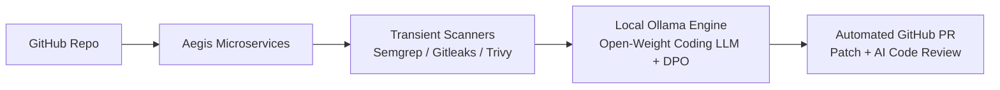

*This is a submission for the [Hacktoberfest Open-Source AI Challenge Week 2: Side Hustle](https://dev.to/challenges/hacktoberfest-week2-2026-10-12)*

> **Team Submission:**  
> - Krish ([@krishtrue](https://dev.to/krishtrue))  
> - Keshav ([@keshav](https://dev.to/keshav))

---

## What I Built

Every developer and freelancer knows the feeling: you run a security audit before handing off a project to a client, and suddenly your terminal floods with dozens of alerts — leaked API keys, outdated CVEs, SQL injection risks, and unescaped inputs.

Triaging and manually writing code patches for all of them takes hours of tedious context switching.

Large enterprises spend thousands of dollars on tools like Snyk or GitHub Advanced Security. But for **freelancers, boutique development agencies, and solo founders**, existing solutions present two massive roadblocks:

1. **The Privacy & Compliance Dilemma:** You cannot feed confidential client code or unpatched zero-day vulnerabilities into closed cloud AI APIs (like OpenAI or Anthropic). Doing so violates NDAs, enterprise security policies, and client trust.
2. **The Per-Token Margin Killer:** Closed AI APIs charge per token. Analyzing whole files and generating diffs for hundreds of security alerts across dozens of repos destroys the economics of a security side hustle.

### Enter Aegis 🛡️
**Aegis** is a privacy-first, automated DevSecOps platform and security remediation bot with **open-source AI at its very core**.

It connects to your GitHub repositories via a GitHub App, triggers asynchronous security scans (Semgrep for static analysis, Gitleaks for secrets, Trivy for dependencies), and uses **local open-source AI models via Ollama** optimized with **Direct Preference Optimization (DPO)** to automatically generate surgical code fixes and open pull requests directly on GitHub.



### Who Would Pay For It?
- **Freelancers & Agencies:** Who want a "one-click security audit & patch" button before handing over deliverables to clients.
- **Micro-SaaS & Startup Founders:** Who need continuous automated security compliance without leaking proprietary IP.
- **Business Model (The Side Hustle):** A simple flat-rate subscription ($29–$49/month) or self-hosted license for unlimited local scans and automated remediation PRs. Because inference runs on open-weight models locally, our marginal AI inference cost is literally **$0.00**, making healthy SaaS margins possible from day one!

---

## Demo

Aegis features a responsive, glassmorphic dashboard built with React 19, Tailwind CSS v4, and GSAP animations, paired with an asynchronous background worker pipeline.

### Key Capabilities:
- **One-Click Scan & Triage:** View categorized vulnerabilities (Critical, High, Medium, Low) with exact file locations and descriptions.
- **Local AI Patch Generation:** Click "Generate Fix" to have a local open-weight model generate a surgical code replacement without transmitting code externally.
- **Automated Pull Request Creation:** Aegis branches your repo, writes the fix, computes a clean unified git diff, and opens a GitHub Pull Request with structured code review walkthroughs.

<!-- Embed your demo video, GIF, or deployed URL below -->
*Dashboard & PR Creation Demo:*
*(Add your Loom video / demo link / GIF here)*

---

## Code

The entire codebase is open-source and structured as a modern monorepo:



- **GitHub Repository:** [https://github.com/KrishTrue/dev-challange-3](https://github.com/KrishTrue/dev-challange-3)

---

## How I Built It

Aegis is engineered as a scalable microservices architecture managed with `pnpm` workspaces and Turborepo:

```text
├── apps/
│   └── web-2/                      # React 19 + Vite + Tailwind CSS v4 dashboard
├── services/
│   ├── api-gateway/                # Express gateway, JWT auth, Redis rate limiting
│   ├── auth-service/               # GitHub OAuth & user profile management
│   ├── app-integration-service/    # GitHub App installation & repo synchronization
│   └── secure-bot/                 # BullMQ worker & Local AI remediation engine
```

### The Tech Stack:
- **Frontend:** React 19, TypeScript, Vite, Tailwind CSS v4, Zustand, GSAP
- **Microservices & Gateway:** Node.js, Express, TypeScript, Redis, BullMQ
- **Database:** PostgreSQL with multi-schema isolation (`auth`, `integration`, `bot`) via Prisma ORM
- **Transient Scanners:** Semgrep (SAST), Gitleaks (Secrets), Trivy (CVEs)
- **GitHub Automation:** Octokit REST APIs for GitHub App webhooks and automated PR staging

### The Open-Source AI Core: Ollama + DPO

Rather than relying on closed, third-party APIs, our remediation engine is powered by **Ollama** running open-weight coding models (such as `qwen2.5-coder` and `llama3.2`):

1. **Context Extraction:** When a vulnerability is flagged, the worker slices the surrounding code context (approx. 30 lines) directly from the cloned repository.
2. **Structured Patch Generation:** The prompt enforces strict JSON output containing:
   - `explanation`: Contextual reason for the vulnerability.
   - `targetContent`: Exact lines to replace with character-accurate indentation.
   - `replacementContent`: The hardened, secure code block.
3. **Direct Preference Optimization (DPO) Alignment:**
   - Standard generalist models tend to "over-rewrite" code, introducing breaking changes or unwanted reformatting.
   - Using DPO-aligned response prompting and preference pairs, the model is guided to favor **minimal, non-breaking, surgical replacements** over aggressive whole-file rewrites.
4. **Unified Diff & PR Staging:** Aegis computes a standard unified diff using `diff`, writes the changes to an isolated git branch, and uses Octokit to commit, push, and open an automated PR with a CodeRabbit-style markdown code review.

---

## Why Does Open Innovation Matter?

Open-source AI isn't just an alternative for this project — **it is the fundamental reason this project can exist as a viable product.**

### 1. Data Privacy & Zero Data Exfiltration
Security vulnerabilities and source code are the most confidential assets any developer or company owns. No privacy-minded client will allow their zero-day vulnerability reports or proprietary code to be shipped to a third-party closed API provider. By running open-weight models locally with Ollama, **zero bytes of code ever leave the user's infrastructure**.

### 2. $0 Marginal Inference Cost Makes the Business Model Work
Closed APIs charge per input and output token. When scanning full repositories and generating diffs, API costs rapidly compound. Running an open-source model locally on commodity hardware or an existing VPS costs $0 in API fees. This enables offering unlimited security audits and automated fixes at a competitive flat monthly subscription with near-100% gross margins.

### 3. No Vendor Lock-In & Unrestricted Customization
Closed model providers frequently deprecate models, alter system prompts, or refuse prompts containing security exploits due to generic guardrails. With open-weight models, we can freely swap architectures, adjust context lengths, and apply fine-tuning and DPO alignment tailored specifically to security remediation.

---

## My Agent Session

We built and architected Aegis with pair programming assistance from Google Antigravity and DevRelay:



---

## My First User

During development, we gave Aegis to a freelance full-stack developer friend who was preparing a client delivery for an e-commerce backend.

### What happened:
- We connected Aegis to their test repository.
- Within 90 seconds, Aegis identified **2 hardcoded staging API secrets** (via Gitleaks) and **1 unescaped SQL query string** (via Semgrep).
- Aegis automatically spawned a remediation branch and opened a GitHub Pull Request with sanitized environment variable lookups and parameterized database queries.

### Their Feedback:
> *"Normally I have to spend half a Saturday manually checking npm audit and fixing lint/security warnings before client handoff. Seeing an automated PR open with the exact lines fixed without me having to copy-paste code into ChatGPT was awesome. I'd easily pay $30 a month for this on all my client projects just for the peace of mind."*

What they asked for next: Automated dependency version bump PRs and Slack webhook notifications.

---

## Prize Categories

- **Hacktoberfest Open-Source AI Challenge Week 2: Side Hustle**

---

*Built with ❤️ for Hacktoberfest 2026 by Krish ([@krishtrue](https://dev.to/krishtrue)) and Keshav ([@keshav](https://dev.to/keshav))*
